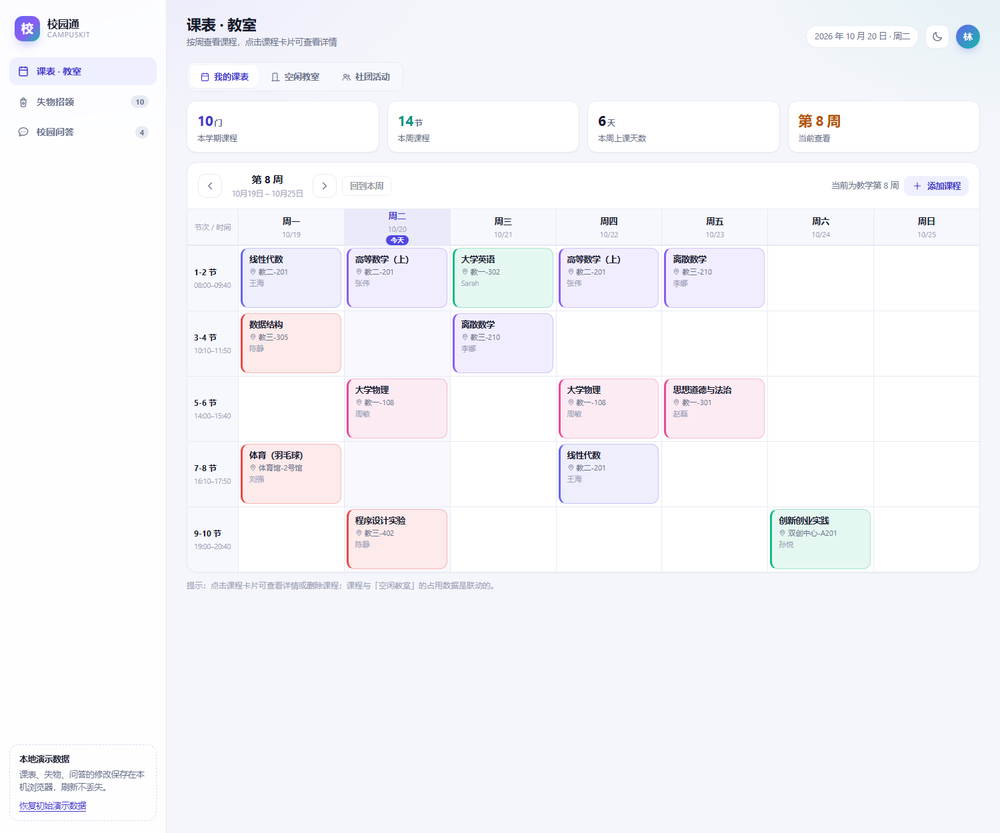
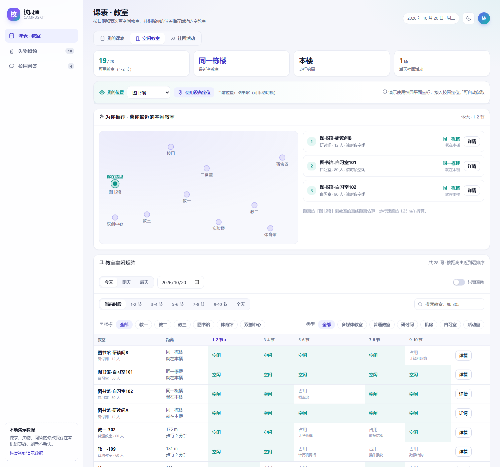
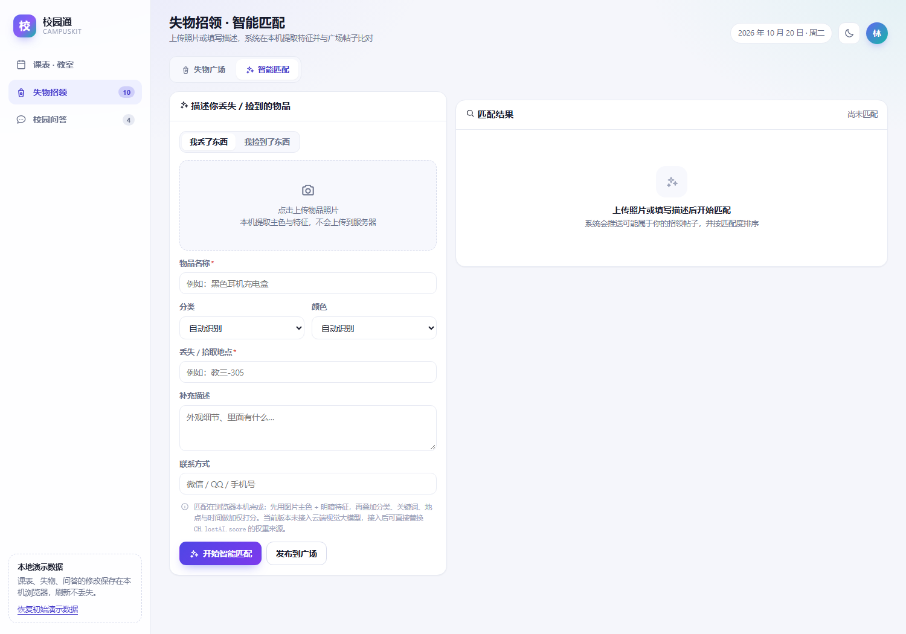
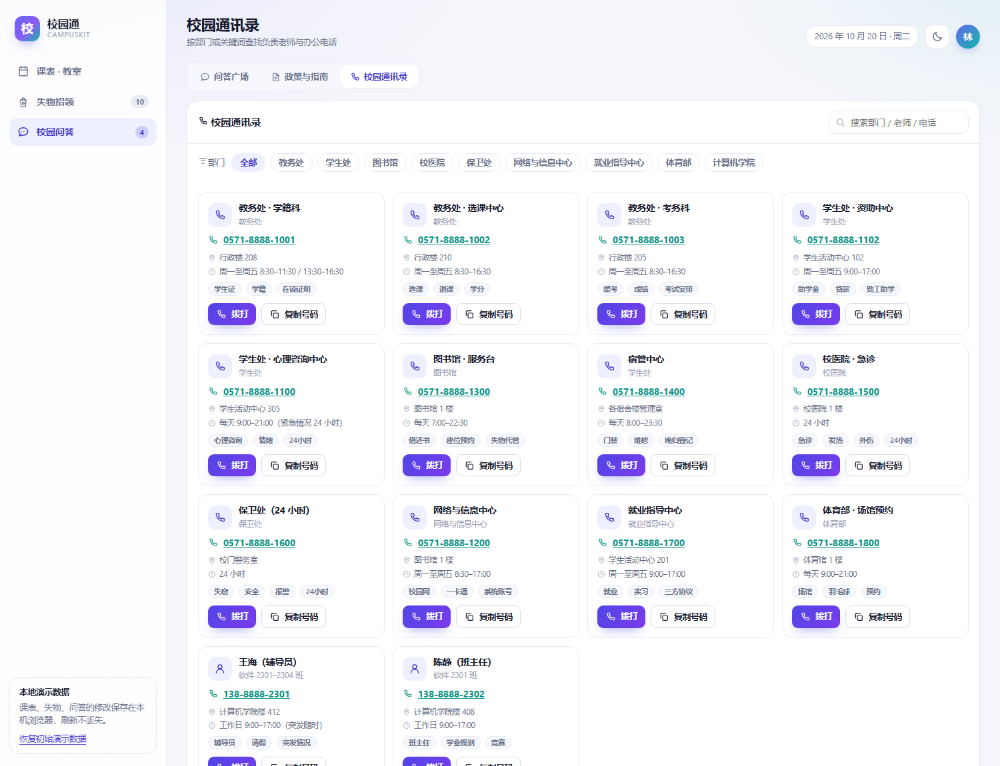
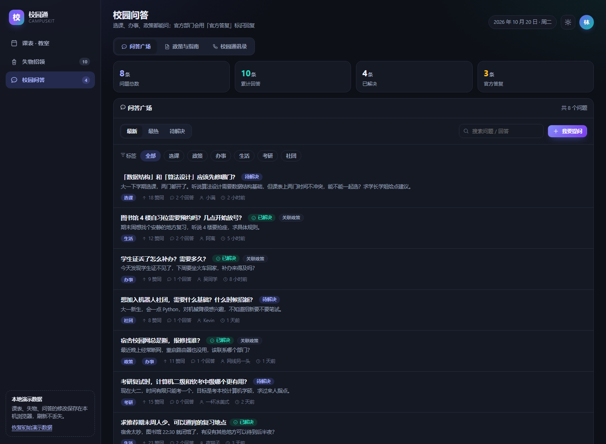
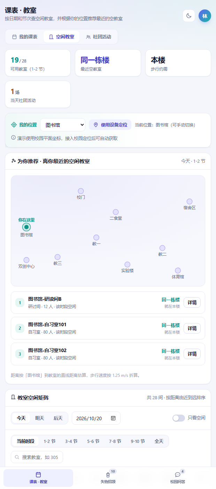

# 校园通 CampusKit

一个面向在校学生的校园服务应用，把**课表 / 空闲教室 / 社团活动**合并成一个视图，另配**失物招领**（支持图片端侧智能匹配）和**校园问答**（含政策指南与校园通讯录）。

提供两种形态：

| 形态 | 位置 | 说明 |
| --- | --- | --- |
| **Windows 桌面软件** | 由 `desktop/build.ps1` 构建（见下） | WinForms + WebView2 原生窗口，独立图标与任务栏条目，双击即用 |
| **网页版** | 本目录 `index.html` | 纯前端零依赖，双击或本地服务打开即可 |

## 界面预览

| 课表 · 教室 | 空闲教室 · 位置推荐 |
| --- | --- |
|  |  |

| 失物招领 · 智能匹配 | 校园问答 · 校园通讯录 |
| --- | --- |
|  |  |

| 深色模式 | 手机端 |
| --- | --- |
|  |  |

> 更多界面截图见 [`docs/`](docs/)（桌面版、手机端、深色模式，共 38 张）。

---

## 桌面版（Windows 软件）

### 直接使用

双击构建产物 `校园通.exe`，或使用 `build.ps1` 自动创建的桌面 / 开始菜单快捷方式「校园通」。
绿色版，无需安装、无需管理员权限、不写注册表；删除文件夹即卸载（`卸载.bat` 可清理快捷方式与本地数据）。

桌面版相比网页版多出的能力：

- **原生窗口**：独立标题栏、任务栏图标、单实例运行（重复启动会自动把已有窗口切到前台）
- **窗口状态记忆**：关闭时记录位置与大小，下次打开原样恢复
- **高 DPI 适配**：在 125% / 150% / 200% 缩放下文字锐利、布局正确
- **可信来源**：本地网页通过 `https://campuskit.local` 虚拟主机映射加载，属于安全上下文，因此「使用设备定位」可用
- **定位权限**：仅自动放行定位，其余权限一律拒绝
- **外链与 tel: 处理**：外部链接、电话链接交给系统默认程序，不在应用内开新窗口
- **启动页参数**：`校园通.exe --page=rooms`（可选 `match` / `policy` / `contacts` / `act` / `lost` / `qa`），可为单个模块单独建快捷方式
- **快捷键**：F5 刷新、F11 全屏、Esc 退出全屏、F12 开发者工具、Ctrl +/-/0 缩放
- **降级方案**：本机若缺少 WebView2 运行时会提示，并可改用系统默认浏览器打开

### 目录结构（`build.ps1` 的输出）

```
校园通\
├── 校园通.exe                  主程序（58 KB，图标已内嵌）
├── 校园通.exe.config           运行时配置（含关键的 loadFromRemoteSources）
├── app.ico                     应用图标
├── Microsoft.Web.WebView2.Core.dll
├── WebView2Loader.dll          原生加载器（x64）
├── 使用说明.txt
├── 创建桌面快捷方式.bat / 卸载.bat
├── app\                        网页资源（index.html、css、js、docs、tests）
├── tools\                      快捷方式安装 / 卸载脚本
└── 源码\                       Program.cs、清单、配置、构建脚本、图标脚本
```

### 重新构建

```powershell
powershell -ExecutionPolicy Bypass -File desktop\build.ps1 -Target "dist\校园通"
```

脚本会自动完成：获取 WebView2 SDK → 生成图标 → 编译原生外壳 → 打包 → 创建快捷方式
（`-SkipShortcut` 可跳过快捷方式；构建前会自动关闭正在运行的实例，避免文件占用）。

### 桌面版端到端验收（可复现）

桌面版可以用 WebView2 的远程调试接口自动化验收，每次改动后都能一键回归：

```powershell
# 1) 带调试端口启动（WebView2 会自动读取该环境变量）
$env:WEBVIEW2_ADDITIONAL_BROWSER_ARGUMENTS = "--remote-debugging-port=9333"
& "dist\校园通\校园通.exe"

# 2) 驱动真实窗口跑一遍全部页面与关键流程，并截图存证
powershell -ExecutionPolicy Bypass -File desktop\_sdk\cdp-verify.ps1
```

最近一次在**真实桌面窗口内**测得的结果：

| 验收项 | 结果 |
| --- | --- |
| 原生标题联动 | `课表 · 教室 · 校园通` |
| 空闲教室 | 推荐卡 3 条、教室矩阵 28 行、校园示意图正常 |
| 课表联动 | 3 个单元格标记为「我的课」 |
| 社团活动 / 失物广场 | 7 张活动卡 / 11 条失物 |
| 政策指南 / 通讯录 | 6 条 / 14 条 |
| **智能匹配实测** | 自动识别「电子 + 黑色」，命中 1 条，理由含分类、颜色、关键词、地点、时间五项 |
| **发布流程实测** | 弹层打开 → 提交 → 卡片 11→12 → localStorage 落库 12 → 清理回 11 |
| 渲染上下文 | viewport `1200×812`，`dpr=1.5`（= 1800×1218 物理像素，DPI 适配正确） |
| JS 运行时异常 | 0 |

截图存证见 `docs/16-桌面版实测-*.png`。

### 桌面版实现中的三个坑（已解决，供后续维护参考）

1. **E 盘被判为「远程位置」**：CLR 会拒绝从 E 盘加载依赖程序集，WebView2 因此启动失败。
   必须在 `校园通.exe.config` 中开启 `<loadFromRemoteSources enabled="true" />`。
2. **高 DPI 下网页只占窗口一角**：`Controller.Bounds` 需要**物理像素**，而 WinForms 的
   `ClientSize` / `DeviceDpi` 在本环境下会返回逻辑值（实测 `DeviceDpi=96` 而系统为 150%）。
   解决：用 `GetDpiForWindow` 取真实 DPI，用 `GetClientRect` 取物理客户区尺寸。
3. **清单声明 DPI 感知**：仅靠 app.config 的 `DpiAwareness` 不生效，必须在
   `app.manifest` 中声明 `PerMonitorV2` 并以 `/win32manifest` 编译进 exe。

> 编译环境限制：本机只有 .NET Framework 自带的 csc（仅支持 **C# 5**），因此 `Program.cs`
> 刻意未使用字符串插值、`?.`、表达式成员等新语法。若日后安装了 Roslyn / VS，可自由升级语法。

---

## 手机 / 电脑两用

同一套代码，电脑端是原生窗口程序，手机端是响应式网页 + PWA。手机端**没有**原生 APK（本机无 Java / Android SDK 工具链），而是用浏览器能力做到"接近原生"：

### 手机上怎么用

| 方式 | 做法 | 能力 |
| --- | --- | --- |
| **局域网直连**（最快） | 电脑打开「校园通.exe」→ 点左下角「手机访问」→ **手机扫码**（或手输给出的地址） | 全功能可用；iOS 可直接「添加到主屏幕」安装 |
| **装成手机 App（PWA）** | 把 `index.html / css / js / icons / manifest.webmanifest / sw.js` 放到任意 HTTPS 静态托管，手机浏览器菜单选「添加到主屏幕」 | 全屏无地址栏、可离线（Service Worker 缓存）、定位可用 |

### 安装到手机桌面（分平台）

各平台规则不同，应用内已做统一入口（侧边栏「安装到桌面」+ 手机端自动提示条），会按当前设备给出对应步骤：

| 平台 | 局域网 http | HTTPS |
| --- | --- | --- |
| **iOS / iPadOS**（Safari、Edge、Chrome） | ✅ 分享 →「添加到主屏幕」，独立全屏窗口（已声明 `apple-mobile-web-app-capable`） | ✅ 同上 |
| **Android**（Chrome、Edge、华为、QQ、UC） | ⚠️ 浏览器策略只允许「添加到主屏幕」建快捷方式 | ✅ 菜单 →「安装应用」，桌面图标 + 离线可用 |
| **桌面**（Chrome、Edge） | — | ✅ 地址栏安装图标 |

安卓要完整安装必须走 HTTPS（浏览器安全策略，非本应用限制）；把 `app` 目录丢到任意静态托管即可满足。需要真正的 APK 时，可把 `app` 目录交给在线打包服务（如 PWABuilder）生成。

电脑端为此内建了一个**只读内网静态服务**（`LanServer.cs`，用 `TcpListener` 手写，因此不需要管理员权限的 URL ACL），点「手机访问」时才按需启动，关闭软件即停止。

### 浏览器兼容性

界面刻意避开了新语法，以覆盖国产浏览器内核（vivo / 华为 / 小米 / OPPO / 三星 / QQ / UC / 微信内置常见 **Chromium 86–108**）：

| 曾用的现代特性 | 处理 |
| --- | --- |
| `color-mix()`（Chrome 111+ / Safari 16.2+）**共 22 处** | 全部改为 `rgba(var(--*-rgb), a)`，主题色以 RGB 分量变量给出；视觉等价，支持面降到 Chrome 49+ |
| `inset: 0`（**Chrome 87+**）**2 处** | 改为 `top/right/bottom/left` 四向展开。老内核下原写法会让**弹层遮罩塌成 0 尺寸（所有对话框失效）**、照片上传热区不可点 |
| `backdrop-filter` | 同时输出 `-webkit-backdrop-filter` |
| `100dvh` | 保留 `100vh` 在前作为回退 |
| `env(safe-area-inset-*)` / `min()` / `max()` | 仅用于间距与限宽，缺失时不影响结构 |

JS 侧同样干净：`?.`、`??`、`structuredClone`、`String.replaceAll`、`Array.flat`、`Array.at`、`Object.fromEntries` **均为 0 处**，因此 Chromium 86+ 与 iOS Safari 15+ 均可运行。

已知差异（不影响功能）：Chromium 84 以下不支持 flex `gap`，元素间距会紧凑一些。

验证方式（三条，均可复现）：

1. **视觉回归**——改写后读取课程卡底色、边框色、空闲单元格、侧边栏毛玻璃等计算值，与改造前比对一致
2. **布局回归**——390×844 `mobile=true` 设备仿真，7 个页面零横向溢出；并逐项确认弹层遮罩 `top/right/bottom/left` 均为 0 且实际尺寸等于视口
3. **UA 矩阵**——13 种真实 UA（vivo / 华为 / 小米 / OPPO / 三星 / QQ / UC / 安卓 Chrome / Edge / 微信 ×2 / iPhone Safari / 桌面 Edge）逐个加载，验证平台识别与安装指引文案：

| 浏览器 | 识别 | 指引首步 |
| --- | --- | --- |
| vivo 浏览器 | `vivo` | 底部「≡」或「更多」→「添加到桌面」 |
| 华为 / 小米 / OPPO / QQ / UC | 对应品牌 | 底部「≡」→「添加到桌面」 |
| 三星浏览器 | `samsung` | 右下角「≡」→「添加页面到」→「主屏幕」 |
| 安卓 Chrome | `chrome` | 右上角「⋮」→「安装应用」 |
| 安卓 Edge | `edge` | 底部「⋯」→「添加到手机」 |
| **微信内置（安卓/iOS）** | `wechat` | **如实提示：不支持安装，请「⋯」→ 在浏览器打开** |
| iPhone Safari | `safari` | 底部「分享」→「添加到主屏幕」 |
| 桌面 Edge | `edge` | 地址栏安装图标（桌面版本身已是独立窗口） |

### 二维码（无外部依赖）

「手机访问」弹层里的二维码由项目自带的编码器生成（`js/qr.js`，约 300 行），不引任何第三方库、不联网：

- 字节模式 + UTF-8，纠错等级 **L**，版本 1–4 自动选择（21×21 ~ 33×33）
- 版本 1–4 在 L 级下均为单块，无需块交织
- 标准 **8 种掩码**按规范四条罚分规则择优，格式信息按 BCH(15,5) 生成
- 输出为 **SVG 矢量**（`shape-rendering="crispEdges"`），任意缩放都锐利，自带 3 模块静区

**验证方式（关键，不是"看着像"）**：

| 验证 | 方法 | 结果 |
| --- | --- | --- |
| 编码正确性 | 与 npm `qrcode` 参考实现**逐模块比对**（锁定同一掩码） | 同一掩码下 **0 处差异** |
| 可扫描性 | 渲染成像素后用 npm `jsqr` **真解码** 10 组内容 | **10/10 还原原文** |
| 屏幕实际效果 | 从真实窗口截图 → jsQR 解码 | 解码结果与页面显示地址**完全一致** |

复现命令（需要 `npm i jsqr` / `npm i pngjs`）：

```powershell
node tests\qr-verify.cjs                 # 编码 → 渲染 → 解码
node tests\qr-verify.cjs -p shot.png     # 从截图解码
```

开发过程中这套验证抓出了 3 个真实缺陷：**RS 生成多项式系数写反**（低阶时因对称看不出来）、**格式信息两份拷贝的行列转置**、以及**成功结果被 4 秒超时判定覆盖**的竞态。

### 手机端适配做了什么

- **响应式**：≤880px 切换为单列布局 + 底部标签栏，安全区（刘海屏 / 底部横条）用 `env(safe-area-inset-*)` 处理
- **输入框 16px**：iOS Safari 聚焦输入框会自动放大页面，移动端统一把输入字号提到 16px 规避
- **触控热区**：移动端 chip / 按钮 / 图标按钮放大到接近 44px
- **`100dvh`**：兼容移动端浏览器地址栏收放导致的 100vh 计算偏差
- **PWA**：manifest（含 4 个快捷方式）、安装图标（含 maskable 与 apple-touch）、Service Worker 离线缓存

### 手机端验收结果（真实设备仿真）

用 CDP `Emulation.setDeviceMetricsOverride` 做真机尺寸仿真（`390×844 @dpr3, mobile=true`）——**不能用 `--window-size` 代替**，因为 Windows 有最小窗口宽度，会把页面撑到 ~500px 造成误判（这次就踩到了）。

| 页面 | innerWidth | documentScrollWidth | 结果 |
| --- | --- | --- | --- |
| 课表 / 空闲教室 / 社团活动 / 失物招领 / 智能匹配 / 校园问答 / 通讯录 | 390 | 390 | **7 个页面全部零横向溢出** |

同一套自测在 390 / 430 / 600 / 900 / 1100 / 1500px 六档宽度下均为 **39/39 通过**。截图见 `docs/20-手机端-*.png`。

### 内网服务的安全校验

| 测试 | 结果 |
| --- | --- |
| 资源与 MIME（含 `manifest.webmanifest` → `application/manifest+json`） | 全部 200，类型正确 |
| 不存在的文件 | 404 |
| 5 种目录穿越（含 `%2e%2e` / `%2f` 编码变体） | 全部 403，无任何文件泄漏 |
| POST 等写操作 | 405 Method Not Allowed（只读） |
| 关闭软件 | 端口随之关闭 |

> 数据说明：电脑与手机的数据**各自独立**（localStorage 分设备），不做同步，也都没有后端。若要多人共享，需要接服务端。

---

## Android APK

发布位置：构建产物 `校园通.apk`（631 KB，含安装说明；其中高德地图底图 437 KB）。因体积与签名原因，APK 未纳入源码仓库，请见 Releases 页。

**离线可用**：网页资源全部打包进 APK，安装后不联网也能用；minSdk 21（Android 5.0），targetSdk 34。

**不再提示「安装到桌面」**：原生侧在 UA 里加了 `CampusKitApp/1.0` 标记，网页用 `CH.install.isEmbedded()` 识别后不再弹安装横幅与侧边栏引导（桌面版 `campuskit.local` 同样不弹）；用手机浏览器访问局域网地址时仍会提示，因为那时确实需要安装。

### 实现要点（不是简单套壳）

| 问题 | 做法 |
| --- | --- |
| `file:///android_asset` 属于**不安全来源**：localStorage 受限、Service Worker 被禁用、定位被拒 | 内置只读回环 HTTP 服务（`AssetServer.java`），经 `http://127.0.0.1:随机端口` 发布网页 → WebView 处于**安全上下文**；服务起不来时自动退回 `file://` |
| 回环服务的安全面 | 只绑定 `127.0.0.1`、只支持 GET、只读、拒绝含 `..` 的路径；清单用 `network_security_config.xml` 仅对回环地址放行明文 HTTP |
| 浏览器会预开空闲连接，串行 accept 会互相阻塞 | 每个连接独立线程处理（否则首次加载会卡住） |
| 网页 `<input type="file">` 选照片 | 实现 `onShowFileChooser` + `onActivityResult`，失物招领「上传照片→智能匹配」在 APK 内可用 |
| Android 6+ 定位是**危险权限**，只声明清单不够 | 在 `onGeolocationPermissionsShowPrompt` 里做运行时申请（`requestPermissions`），拒绝时网页侧自动退回手动选位置 |
| 图标 | 自适应图标（Android 8+ 遮罩）+ 旧版 5 档密度 PNG，与网页品牌一致 |

### 构建（不需要 Gradle）

```powershell
powershell -ExecutionPolicy Bypass -File android\build.ps1            # 调试签名
powershell -ExecutionPolicy Bypass -File android\build.ps1 -Release   # 发布签名
```

流程：`aapt2 compile → aapt2 link → javac → d8 → 自行写入 assets（正斜杠条目名）→ zipalign → apksigner`。
脚本会自动下载缺失的 JDK 17 与 Android SDK 组件（build-tools r34 + platform 34）。

### 构建中踩到并修掉的四个坑

1. **aapt2 在 Windows 上把 assets 条目名写成反斜杠**（`assets\app\index.html`），而 Android 的 `AssetManager` 按正斜杠查找 —— 真机上会**全部 404、白屏**。改为不用 `-A`，自己以正斜杠条目名打包。
2. **`apksigner.bat` 需要 `JAVA_HOME`**，否则报 "no 'java' command could be found"。
3. **keytool 把正常信息写到 stderr**，在 `$ErrorActionPreference='Stop'` 下被 PowerShell 误判为致命错误 → 改为按 `$LASTEXITCODE` 判断。
4. **重复打开同一个 zip** 导致 `IOException`（插入代码与原代码叠加），合并为一次打开。

### 验证到了哪一步（诚实说明）

本机**没有安卓设备，也没有模拟器镜像**，因此**未在真机上运行**。已完成的验证：

| 项目 | 结果 |
| --- | --- |
| 清单解析（`aapt2 dump badging`） | 包名 `com.campushub.app`、minSdk 21 / targetSdk 34、三项权限、中文应用名、自适应图标、启动 Activity 全部正确 |
| dex 内容（`dexdump`） | `MainActivity`、`AssetServer` 及内部类、`R` 类均已编入 |
| assets 条目名 | 35 个条目，**反斜杠条目 0 个**；`assets/app/**` 20 个文件齐全 |
| 签名 | v1 + v2 + v3 **全部通过**（覆盖 Android 5.0 ~ 14+），zipalign 4 字节对齐通过 |
| **服务器逻辑（桌面实测）** | 用文件系统桩把同一份 `AssetServer` 跑起来：9 条正常路径 MIME 全对、404 正确、**响应体与源文件逐字节相同（8357/8357）**、**5 种目录穿越（含 `%2e%2e`/`%2f` 变体）全部 404** |

复现命令：`android\_test\`（`ServerTest.java` + `AssetManager` 桩）。


纯前端、零依赖、离线可用：直接双击 `index.html` 就能跑，不需要 Node、不需要构建、不联网。

---

## 快速开始

**方式一：直接打开**

双击 `index.html`（Chrome / Edge 均可）。

**方式二：本地服务（推荐，设备定位功能需要 http 环境）**

```powershell
cd campus-app
python -m http.server 8791 --bind 127.0.0.1
# 浏览器访问 http://127.0.0.1:8791/
```

**自测**：访问 `http://127.0.0.1:8791/?selftest=1`，页面会执行 39 项单元 + 集成测试（含「遍历 8 个页面渲染无 JS 异常」「无横向溢出」「主题切换」「校园地图 1:2000」等），结果写入页面标题与隐藏的 `<pre id="selftest">`。命令行验证（新版本 Edge/Chrome 已不支持 `--dump-dom`，改用 CDP 驱动，见 `tools/run-selftest.mjs`）：

```powershell
node tools/run-selftest.mjs "http://127.0.0.1:8791/index.html"   # 打印 SELFTEST_RESULT 与失败项
node tools/verify-map-ui.mjs                                     # 校园地图 UI 端到端校验（缩放/比例尺/居中/深色主题）
```

**演示开关**：URL 加 `?theme=dark` 或 `?theme=light` 可临时指定主题（不写入本地存储），适合答辩/截图固定配色。

---

## 功能一览

### 一、课表 · 教室（三合一）

**① 我的课表**
- 按周查看（第 1–18 周），学期周次按「秋季 9/1 所在周的周一 / 春季 2/23 所在周的周一」自动推算
- 今天所在列高亮并显示「今天」；当前节次高亮；本周/非本周状态提示
- 点击课程卡片看详情（教师、时间、地点、周次），可删除
- 可添加课程：周次类型支持每周/单周/双周，**保存前做时间冲突检测**，冲突会明确提示与哪门课撞车

**② 空闲教室**
- 27 间教室 × 5 个大节（1-2 / 3-4 / 5-6 / 7-8 / 9-10 节）的空闲矩阵，按日期查询（今天/明天/后天/任选日期）
- 支持按楼栋、教室类型（多媒体/普通/研讨间/机房/自习室/活动室/实验室）筛选，按教室号搜索，「只看空闲」开关
- 表格按**离你的距离由近到远**排序，每间教室给出距离与步行时间
- 教室详情：容量、类型、当天 5 个时段的占用明细（含占用课程名）+ 空闲时段汇总 + 一键复制

**③ 位置推荐（按当前位置找最近教室）**
- 位置来源两种：**下拉手动选择**（图书馆 / 明实楼 / 南明楼·北德楼 / 德泽楼 / 体育馆 / 体育场 1·2 / 篮球场 / 北苑餐厅 / 南苑餐厅 / 公交站），或**使用设备定位**（浏览器 Geolocation）
- 顶部推荐卡给出**最近的 3 间空闲教室**，含距离、步行时间，并在**校园地图**上画出「你在这里」到推荐教室的连线
- **校园地图（北方民族大学，1:2000）**：底图为**高德地图**（z=18 路网瓦片，按校园范围批量抓取后拼接），按 **图上距离 : 实地距离 = 1 : 2000** 绘制（1 px = 0.529167 m 实地，图上 1 cm = 实地 20 m）
  - 配准：高德瓦片是 GCJ-02 墨卡托坐标，逐瓦片换算 **GCJ-02 → WGS84** 后投影到本模块的局部平面坐标，与 OSM 实测点、GPS 定位同一套坐标，**不需要手工标定**；底图分辨率 0.467 m/px（z=18 在纬度 38.5° 的理论值），比 1:2000 的 0.5295 m/px 更细，显示时轻微缩小所以不发虚
  - 刷新底图：`python tools/fetch_amap_base.py`（改范围/级别后重跑即可，参数写到 `img/base-amap.json`）
  - 图上叠加**实测矢量层**：图书馆、明实楼、南明楼·北德楼、德泽楼、体育场 2、篮球场为 OSM 真实轮廓（虚线），体育馆、体育场 1、餐厅、公交站为实测点位
  - **底图可切换**：工具条上「矢量图 / 高德图」按钮在高德底图与实测矢量图之间切换（矢量图线划在任何缩放下都锐利，适合量距），切换时保持当前视野与缩放
  - 100 m 淡网格 + 固定比例尺 + 指北针；可拖动平移、三档缩放（1:4000 / 1:2000 / 1:1000，标尺与比例标注随缩放同步换算），右下角全校总览小图显示当前视野框，点击可定位；浅色/深色主题各自适配
- 距离用 Haversine 直线距离，步行时间按 1.25 m/s 折算；同一栋楼显示「同一栋楼 / 就在本楼」而不是「0 m」

**④ 社团活动**
- 7 场活动的活动卡：社团、时间、地点、周次、报名进度、报名/取消报名
- 活动占用教室会**同步体现在空闲教室矩阵**里（紫色标记）
- 与课表共用同一套占用计算，不存在「课表有课但教室显示空闲」的矛盾

### 二、失物招领

- **失物广场**：招领/寻物两类信息，支持分类、状态、关键词筛选；卡片显示物品照片（有则显示）、分类、颜色、地点、时间、发布人
- **发布信息**：类型、名称、分类、颜色、地点、时间、描述、联系方式，可附照片
- **智能匹配**（核心）：失主填写/上传丢失物件后，自动推送可能匹配的招领帖
  - 上传照片 → 端侧提取**主色**（HSL 色相 + 饱和度加权，纯色物体按明度归为黑/白/灰）与明暗特征
  - 没有照片时 → 从文字中识别**分类**（耳机→电子、校园卡→证件…）与**颜色**
  - 与广场帖子做加权打分：分类 26 分 + 颜色 24 分（素色之间 10 分）+ 关键词重合最多 30 分 + 地点楼栋 10 分 + 时间接近 8 分，输出**匹配度百分比与匹配理由**
  - 只匹配**类型互补**（我丢了 → 找招领帖）且**未归还**的帖子，按匹配度排序
- 详情弹层支持复制联系方式、标记已归还/已找到

### 三、校园问答

- **问答广场**：最新/最热/待解决排序，标签筛选，关键词搜索；提问（标题、补充说明、最多 3 个标签、可匿名）、回答（可匿名）、赞同、设为最佳回答（自动置为已解决）
- **官方答复**标识：来自教务处的回答会带「官方答复」徽章
- **关联政策**：问题可关联到具体政策条目，详情页一键跳转查看
- **政策与指南**（6 条）：校园网报修、学生证补办、缓考缓修、图书馆座位预约、宿舍门禁、勤工助学 —— 每条包含**责任部门、联系电话、办理地点、办公时间、适用对象、所需材料、办理流程步骤、注意事项**
- **校园通讯录**（14 个）：教务处（学籍科/选课中心/考务科）、学生处（资助中心/心理咨询）、图书馆、宿管中心、校医院急诊、保卫处、网络与信息中心、就业指导中心、体育部场馆预约，以及**辅导员、班主任**的联系方式与办公地点；支持按部门筛选、关键词搜索、一键 `tel:` 拨打、复制号码

---

## 关于「AI」与「定位」的能力边界（重要）

为了不做虚假宣传，这两处能力如实标注如下，界面上也有对应说明：

| 能力 | 当前实现 | 说明 |
| --- | --- | --- |
| 图片智能推送 | **端侧特征匹配**：Canvas 像素统计提取主色/明暗，叠加文本关键词与时空特征加权打分 | 未接入云端视觉大模型。替换点已隔离在 `CH.lostAI.score()` / `CH.lostAI.analyzeImage()`，接入视觉 API 后可直接替换特征来源 |
| 教室位置推荐 | **浏览器 Geolocation + 校园平面坐标**：距离用 Haversine，步行按 1.25 m/s 折算 | 底图为**高德地图**（GCJ-02→WGS84 配准），矢量校核数据为北方民族大学实测坐标（WGS84，来自 OpenStreetMap）；定位精度取决于设备 GPS（室外 5–15 m），接入室内定位（蓝牙信标/UWB）后室内也可用 |
| 教室占用数据 | 我的课程 + 社团活动为**真实数据**；其余「其他班级」占用按房间/日期/节次**确定性生成**（同一天结果稳定，不会每次刷新变化） | 接入教务系统后替换 `CH.occupancy` 的生成逻辑即可 |
| 电话与政策 | 号码格式与真实一致，但为**演示数据，不可真实拨打** | 上线前需替换为学校公开号码与最新文件 |

---

## 目录结构

```
campus-app/
├── index.html            入口：布局骨架 + SVG 图标精灵 + 运行时错误收集
├── css/styles.css        设计系统（浅色/深色双主题、组件、响应式）
├── js/
│   ├── util.js           日期/学期周次/地理/文本特征/剪贴板等工具
│   ├── campus-map.js     北方民族大学校园地图（高德底图配准 + 1:2000 绘制/交互）
│   ├── data.js           静态数据 + 演示种子数据（课程、活动、失物、问答、政策、通讯录、教室）
│   ├── store.js          状态管理 + localStorage 持久化 + 订阅通知
│   ├── ui.js             图标、Toast、弹层、确认框、空状态
│   ├── occupancy.js      教室占用计算（课程 + 活动 + 生成数据）
│   ├── timetable.js      课表 / 空闲教室 / 社团活动（合并视图）
│   ├── lost.js           失物招领 + 图片端侧分析 + 匹配打分
│   ├── qa.js             问答广场 / 政策指南 / 通讯录
│   └── main.js           导航、哈希路由、主题、头部、个人资料
├── img/
│   ├── base-amap.jpg     高德地图瓦片拼接底图（z=18，2560×2048，437 KB）
│   └── base-amap.json    底图配准参数（mPerPx / x0 / y0）
├── tests/
│   ├── selftest.js       39 项自测（?selftest=1 时加载）
│   └── campus-map-verify.cjs  地图数据、底图配准与 1:2000 比例尺校验（Node，无需浏览器）
└── tools/
    ├── run-selftest.mjs  无头浏览器跑 selftest（CDP），用于改动前后基线对比
    ├── verify-map-ui.mjs 地图 UI 端到端校验（缩放联动/标尺长度/居中/深色主题/手机端）
    ├── shot-vector.mjs   导出矢量底面大图，用于配准核对
    └── fetch_amap_base.py 抓取并拼接高德瓦片底图（含 GCJ-02→WGS84 配准）
```

## 设计要点

- **路由**：哈希路由，`#/tt`、`#/tt/rooms`、`#/tt/act`、`#/lost`、`#/lost/match`、`#/qa`、`#/qa/policy`、`#/qa/contacts`，可直接分享链接、可无障碍跳转，无需额外 JS 事件绑定
- **持久化**：改动写入 `localStorage`（键 `campushub.state.v2`），失败时（如配额不足）会提示，不会静默丢数据；侧边栏「恢复初始演示数据」可重置
- **响应式**：≤880px 时侧边栏变底部标签栏，课表横向滚动，卡片单列
- **无障碍**：语义化标签、`aria-label`、焦点自动聚焦到弹层、Esc 关闭、表格标题 `scope`
- **主题**：跟随系统深浅色，可手动切换并记住选择

## 已知限制

1. 无后端：数据存于本机浏览器，换设备/换浏览器不共享；多人协作场景需接入服务端
2. 图片存 `localStorage`（压缩为 560px JPEG），数量多时可能触及 5MB 配额
3. 教室占用中的「其他班级」为生成的演示数据，非真实排课
4. 校园坐标为虚构值，定位推荐的距离仅用于演示交互
5. 学期周次按 9/1、2/23 简单推算，未接入学校校历

## 接入真实系统的改造点

| 目标 | 改造位置 |
| --- | --- |
| 真实课表 / 教室占用 | `js/occupancy.js`：用教务系统接口替换 `genEvent()` 生成逻辑 |
| 真实校园坐标 / 室内定位 | `js/data.js` 的 `BUILDINGS` / `ANCHORS`；`timetable.js` 的 `useGeo()` |
| 视觉大模型识图 | `js/lost.js` 的 `analyzeImage()` / `score()`：把端侧特征替换为模型返回的标签与置信度 |
| 数据云端共享 | `js/store.js`：把 localStorage 读写换成 HTTP 接口，保留 `subscribe()` 通知机制即可 |
| 政策与电话 | `js/data.js` 的 `POLICIES` / `CONTACTS` |
